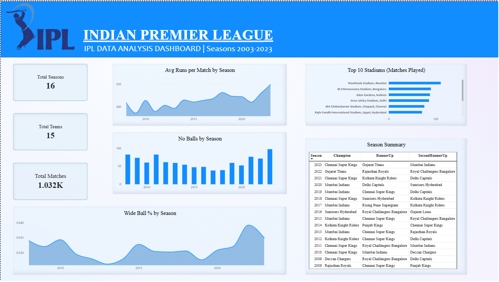
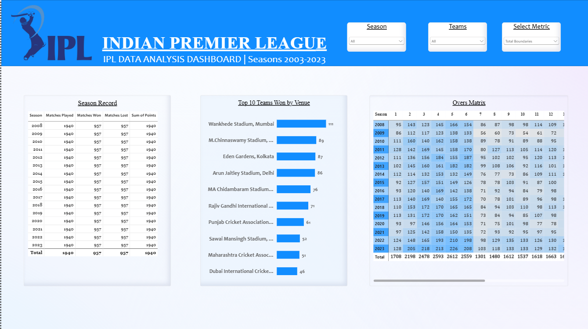
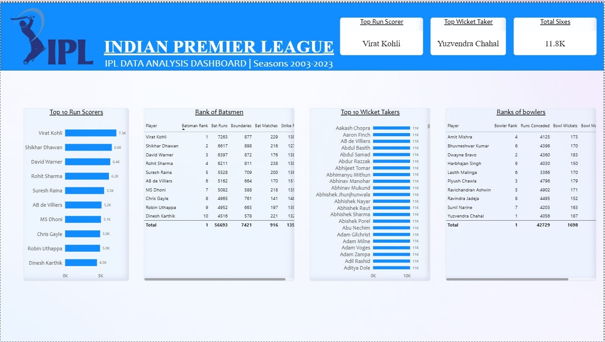

# 🏏 IPL Data Analysis & Visualization Dashboard

This project transforms raw IPL data into meaningful insights through interactive visualizations, KPIs, and analytical comparisons.

---

## 📊 Project Overview

The dashboard provides an overview of IPL tournaments, team performance, and individual player statistics, helping users explore cricket data from different analytical perspectives.

## ✨ Dashboard Features

### 1. IPL Overview
- Team participation and performance overview.
- Key performance indicators (KPIs).

### 2. Team Profile
- Team-wise match performance.
- Matches won and lost.
- Team performance comparisons.
- Venue-based analysis.

### 3. Players Rankings
- Top run scorers.
- Leading wicket takers.
- Player performance rankings.
- Batting and bowling statistics.

---

## 🛠️ Tools & Technologies

| Tool | Purpose |
|---|---|
| Microsoft Power BI | Dashboard development |
| Power Query | Data cleaning and transformation |
| DAX | Measures and calculations |
| Data Visualization | Interactive charts and insights |

---

## 📷 Dashboard Preview

### IPL Overview


### Team Profile


### Players Rankings


---

## 📁 Repository Structure

```text
IPL-Data-Analysis/
│
├── IPL-Data-Analysis.pbix
├── README.md
│
├── screenshots/
│   ├── ipl-overview.png
│   ├── team-profile.png
│   └── players-rankings.png
│
```

---

## 🎯 Project Objectives

- Analyze IPL tournament statistics.
- Compare team performances across seasons.
- Identify top-performing players.
- Develop interactive and user-friendly dashboards.
- Convert raw data into actionable insights.

---

## 💡 Key Learnings

Through this project, I strengthened my understanding of:
- Data cleaning and transformation.
- Data modeling and DAX calculations.
- KPI development.
- Interactive dashboard design.
- Analytical storytelling using Power BI.

---

## 👩‍💻 Author

**Muskan Adnan**

Aspiring Data Scientist | Power BI Enthusiast

- [LinkedIn](https://www.linkedin.com/in/muskan-adnan/)
- [GitHub](https://github.com/muskanadnan07-svg)

---

⭐ If you find this project interesting, feel free to explore the repository and share your feedback!

#PowerBI #IPLDataAnalysis #DataVisualization #DataScience